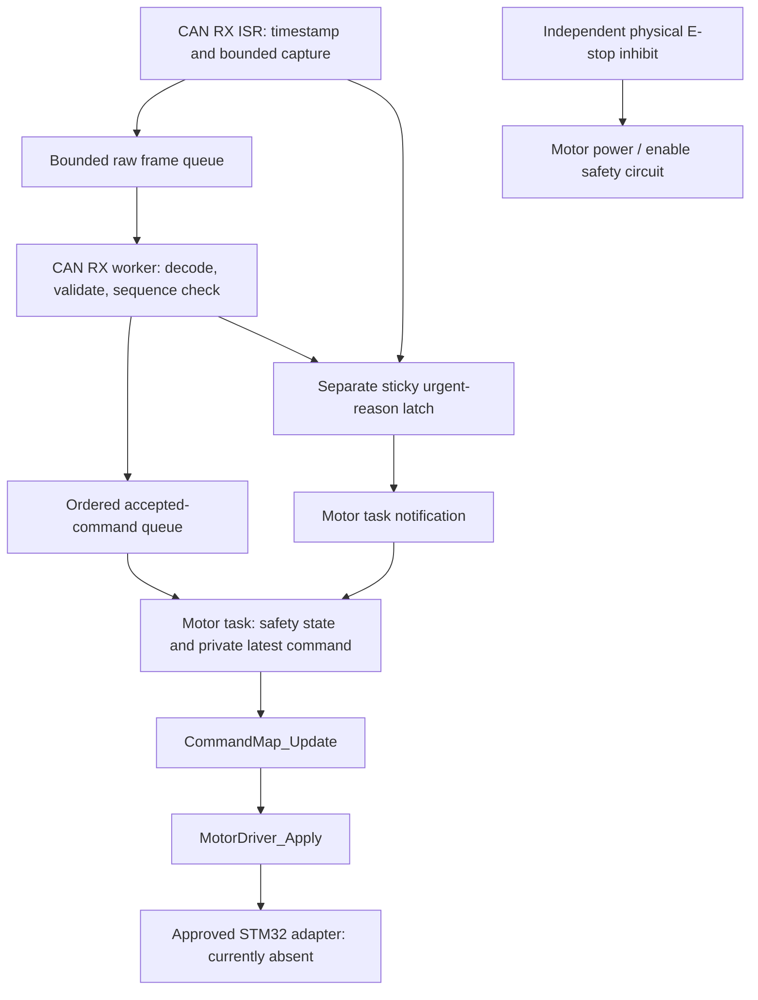

# Bluepill command and safety architecture

This document records the portable-foundation milestone. The subsequent native
FreeRTOS/HAL integration and current build results are in
[FIRMWARE_INTEGRATION.md](FIRMWARE_INTEGRATION.md). The original foundation code
and tests described here are preserved; references below to absent RTOS/HAL
modules describe that earlier milestone, not the current checkout.

Implemented on `feature/gp-actuator-integration`, using Maintaining as the base.
This work adds independently executable portable control code and deterministic
host simulations. It does **not** provide a running CAN/FreeRTOS image, a
production decoder, or a physical motor adapter. The existing generated main
still has an empty foreground loop. The firmware is **not ready for powered
operation**.

The previous mapping/driver repair, its shared revision-10 types, and its 18
tests are unchanged. The working tree already contained staged changes when
this work began; they were preserved. No branch, commit, merge or push was
created, and no hardware was flashed or enabled.

## Implemented data flow and ownership



| Context | Responsibility / integration entry |
| --- | --- |
| CAN RX interrupt | Capture a frame and IDE/RTR metadata, call `GpControl_CaptureIsr`, report hardware FIFO overrun through `GpControl_LatchFault`. No decoding, mapping, motor write, Stop or logging. |
| CAN RX task, next-highest application priority | Call `GpCanRx_Run` when notified. It handles at most the configured frame budget, preserving accepted event order. |
| Motor task, highest application priority | Own `GpMotorTask`, initialize map/driver, call `GpMotor_Run` periodically and on notifications, and process explicit local recovery requests through `GpMotor_Recover`. This is the only software owner of motor-driver operations. |
| Diagnostics, low priority if later added | Consume snapshots published by the motor task. Do not read its mutable state or write outputs. No diagnostic task or logger is implemented here. |

There is no STOP task. Notification is a wakeup, not a command mailbox. The
sticky reason mask remains authoritative even if notifications coalesce or a
queue is full.

`GpControl` is shared channel storage accessed only through the implementation
and its required critical-section callbacks. `GpCanRxTask` belongs to the CAN
task. `GpMotorTask`, including latest command, mapping history, driver state and
diagnostics, belongs to the motor task. Static allocation is supported; there
is no heap use and no shared mutex for the latest command.

## Interfaces and missing decoder

`lib/control/include/gp_control.h` defines the portable entry points and the
mandatory `GpControlPort` callbacks:

- `enter` / `leave`: save and restore interrupt state, with memory ordering;
  serialize every shared-channel access across tasks and relevant interrupts.
- `now_ms`: one monotonic wrapping uint32 millisecond clock, usable in ISR and
  task contexts.
- `notify`: nonblocking, retained task notification, using the correct ISR or
  task variant according to `from_isr`.
- `read_inputs`: read physical E-stop health, CAN health, an explicit hardware
  approval gate, and any unprocessed hardware RX backlog.
- `discard_rx`: establish a bounded hardware receive barrier after outputs
  are off, discarding pre-shutdown frames in hardware FIFOs and port buffers.
  Return false if that cannot be established; recovery then stays inhibited.

No production implementation of these callbacks is fabricated. They must be
reviewed together with the physical adapter and measured before deployment.
Initialization must complete before enabling CAN interrupts; live objects must
not be reinitialized by other tasks.

`GpCanRx_Init` accepts a decoder function with the exact `GP_DecodeCan`
signature. Once Ahmed's implementation is available, pass `GP_DecodeCan`
directly. The repository currently has its declaration only. Passing NULL
leaves the dependency unavailable and the motor supervisor inhibits motion.
There is no weak fallback or production wire decoder.

The boundary requires decoder `GP_OK` to mean a structurally valid frame,
including an invalid-neutral STOP whose VALID bit is low. Any other result is
rejected without using partially decoded output. If Ahmed's decoder reports
`GP_INVALID` for such a well-formed STOP, this distinction must be resolved
before integration; do not trust an output struct from a failed decode.

The portable layer rejects extended frames, remote frames, identifiers other
than `GP_CAN_COMMAND_ID`, and lengths outside 1..8 bytes. Exact GP payload
length, byte layout, reserved payload fields and any integrity checks belong
to Ahmed's decoder; the available shared header does not specify them.
Decoded values must be throttle 0..1000, steering -1000..1000, and contain no
unknown flags. A VALID-low command is accepted as STOP only when both axes
are neutral; asserted known ARM/DEADMAN bits never turn that STOP into motion.
VALID-low non-neutral commands and malformed data are rejected.

The test decoder uses payload bytes solely as an index into a fixture array.
It is intentionally not a CAN protocol encoding and is linked only into host
tests.

## Sequence, timing and residence

| Setting | Provisional default | Enforcement |
| --- | --- | --- |
| Motor update period | 10 ms | Ordinary writes are no more frequent than this period; urgent safety processing does not wait for it. |
| Command timeout | 200 ms | Reception age at or above this value shuts down. Duplicates and malformed frames never refresh it. |
| Residence per queue stage | 40 ms | Raw receive-to-decode/publication and event publication-to-motor processing each allow at most this value. |
| Raw/event capacities | 8 each | Configurable up to compiled storage limits, default maximum 16 each. |
| RX/event work budgets | 8 each | Configurable up to the respective compiled maximum. |

These are assignment proposals, not measured acceptance values. There are no
default approved motor duty, STEP frequency or pin values.

Sequence comparison uses uint16 modulo subtraction. Only forward deltas
1..32767 are fresh after the first structurally/content-valid sample in a
generation. Zero and 32768..65535 are rejected. Gaps are not labelled lost
frames. A sequence is advanced only after successful ordered publication.

Reception time is recorded in `GpControl_CaptureIsr` before queueing, then
carried unchanged through both stages. A late motor task cannot make an old
command young by timestamping it again. Decoder execution time is included
in first-stage residence. Actual elapsed output-update time is passed to
the mapper; an elapsed time above its configured maximum is a timing fault.
On arming, slew timing starts from that new armed interval, not from idle boot
time. A new frame arriving after an existing command timed out cannot conceal
that timeout.

Unsigned subtraction handles clock rollover. Intervals are below 2^31 ms,
and the platform must service the clock within that half-range; future-looking
timestamps fail the age checks. Use the same clock source and units everywhere.
RTOS ticks must be converted appropriately; do not assume one tick is 1 ms.

Sender restart can make its sequence stale. Timeout/fault shutdown followed by
explicit local recovery starts a new generation and resets sequence acquisition.
It still requires neutral/ARM-low followed by a fresh ARM rising edge. A reset
whose sequence happens to look like a forward modulo delta is indistinguishable
from normal wrap/gaps with the present wire contract; guaranteed reset detection
would need an agreed sender session identifier or explicit reconnect signal.

## Motor-owned state machine

| State | Behavior / transition |
| --- | --- |
| DISARMED | Startup state; Init has requested off. ARM-high alone cannot arm. |
| WAIT_FOR_NEUTRAL | Require a fresh valid command with both axes neutral and ARM low. |
| WAIT_FOR_ARM_EDGE | A subsequent fresh ARM rising edge with DEADMAN asserted permits ARMED. Non-neutral ARM-low invalidates the neutral candidate. |
| ARMED | Motion additionally requires a fresh command, VALID/ARM/DEADMAN, healthy physical inputs, explicit hardware approval, no fault latch, and trustworthy fully processed input. |
| FAULT_SHUTDOWN | Outputs have been requested off; commands cannot rearm. An explicit local motor-task recovery acknowledgement is required once health/dependencies are restored. |

ARM-low or DEADMAN release while armed initiates shutdown and requires the
neutral/edge handshake again. They are disarming reasons, not hard emergency
faults. A VALID-low neutral STOP has the same recovery handshake after its
shutdown barrier. Hard faults include queue/FIFO overflow, bus-off, E-stop,
timeout, excessive queue age, untrusted backlog, output/mapping errors,
missing dependencies and excess update dt.

Hard-fault recovery is never an incoming ARM command. `GpMotor_Recover` checks
health, performs another off/reset/receive barrier, clears acknowledged latches,
and requires a new handshake received after that barrier. Fault history remains
available to the owning motor task. Farah must choose the external source and
policy for this explicit local acknowledgement.

Permission is checked again on every motor run and immediately before an output
commit. The code does not retain an `enabled=true` across timeout. `GP_PENDING`
from the driver is a safe wait, not an automatic fault. A run before the next
ordinary output deadline returns `GP_OK` after checking safety without writing.
Other driver errors shut down and latch an output fault.

## STOP propagation and recovery barrier

For `101 motion -> 102 STOP -> 103 neutral/ARM-low -> 104 ARM-high`:

1. RX validates freshness of 102 and latches STOP independently of event space.
2. RX wakes motor immediately. The task may preempt RX before decoding 103/104.
3. Motor calls `MotorDriver_Stop`, then `CommandMap_Reset`.
4. After outputs have been requested off, `discard_rx` removes pre-shutdown
   hardware/port RX candidates.
5. Motor advances the generation and flushes both software queues. It clears
   its latest command and records shutdown execution and diagnostic reasons.
6. An in-flight decode carries the old capture generation; its publication is
   rejected even if it completes after shutdown.
7. New post-barrier neutral/ARM-low and ARM-high events are required. Already
   queued 103/104 cannot supply the recovery handshake.

Generation tags are captured in the ISR, not assigned when decoding completes.
This is why flushing the accepted-event queue alone is insufficient. The
hardware discard hook is also necessary: an old hardware-buffered frame must
not acquire a new generation just because its interrupt was delayed.

The barrier and final output commit are serialized against frame/fault
publication. A fault latched after unlock remains set for the next urgent wake.
Only the motor task invokes the software off callback.

Software Stop means an output-disable request. It does **not** prove that a
vehicle physically brakes or that power switches respond correctly.

## Ordering, coalescing and fail-closed backlog

Every accepted command is processed for safety in order. A later throttle
target never overwrites an unprocessed STOP, ARM-low, deadman release or
required neutral transition.

After safety processing, ordinary targets may replace the motor-owned latest
target. If either previously commanded axis reaches neutral, this implementation
conservatively requests **both** outputs off and resets mapping for that update.
This prevents coalescing neutral away, including `neutral -> nonzero` in one
batch. It does not disarm or latch an emergency fault; the retained latest
target may resume after a later full update period. This conservative temporary
coupling is in the supervisor, not a change to the independent-axis mapper.

No nonzero output is issued with raw frames waiting, a current-generation
decode in flight, unread hardware RX, pending accepted events, or urgent faults.
If the motor event budget cannot drain the ordered input, the controller shuts
down with a backlog fault. RX re-notifies itself when its bounded work leaves
raw frames; it batches ordinary motor notifications at the end of that work,
but not urgent STOP/overflow notifications.

This policy deliberately favours inhibition over availability. If motor's
deadline preempts an unfinished decode, it faults rather than guessing whether
that frame is STOP. Real bus/load measurements must establish that the chosen
budgets and priorities provide acceptable availability.

Raw queue overflow, accepted-event overflow, or a hardware FIFO overrun must
latch independently of queue space. If a full raw queue drops STOP itself,
the overflow latch still forces shutdown. If the ordered queue fills before a
decoded STOP, both overflow and STOP are latched. Neither path silently
continues using the previous target.

Mapping arithmetic runs outside the shared lock. Before committing output,
motor locks again and rechecks physical inputs, faults, both queues, in-flight
decode, generation, freshness and elapsed time. A frame or fault arriving in
that gap causes shutdown. The check and `MotorDriver_Apply` execute together
inside a bounded critical section to close the check/write race.

## FreeRTOS and STM32 integration still required

Inspection found only NVIC, RCC and SYS configured in the `.ioc`, with a
72 MHz system clock and 36 MHz APB1 clock. No CAN peripheral, transceiver
configuration, FreeRTOS kernel/port, `FreeRTOSConfig.h`, scheduler, task or motor
timer is present. No generated CubeMX file was changed.

Required CubeMX/board decisions and work:

1. Confirm CAN bit rate, physical pin mapping/remap, transceiver, termination
   and bus-off recovery policy. Configure the standard data-frame filter for
   `0x105`, FIFO pending/overrun/error interrupts and bus-off detection.
2. Give the ISR a fixed hardware-drain budget. Copy actual ID/DLC/data/IDE/RTR
   metadata, call capture promptly, latch overruns before clearing them, and
   re-service any remaining FIFO data. Include hardware pending/FIFO errors
   in the port health read. `discard_rx` must handle both relevant FIFOs and
   any port buffering in bounded time.
3. Add the real FreeRTOS kernel and Cortex-M3 port through CubeMX, configure
   the HAL/RTOS clock relationship, and let generated RTOS handlers replace the
   currently empty SVC/PendSV handlers. Do not duplicate generated handlers.
4. Create statically allocated motor and CAN worker tasks with motor strictly
   above CAN and optional diagnostics below both. Call motor Init **from the
   motor task**; enable CAN only after channels, decoder and motor are ready.
5. Motor waits for a notification **or the remaining time to its next absolute
   periodic deadline**. On every wake call `GpMotor_Run`. Advance periodic
   deadlines without resetting them on each notification; do not use a plain
   uninterruptible delay or restart a full 10 ms wait on every incoming frame.
   On severe lateness, run once and let elapsed-time checks inhibit motion;
   do not busy-loop replay missed actuator writes.
6. CAN waits for its retained notification, calls `GpCanRx_Run`, then blocks
   again. The core re-notifies when more bounded work remains.
7. Implement save/restore critical sections and notifications with legal task
   and ISR APIs. Publishing interrupts must be masked by the same critical
   boundary. Notification callbacks run after leaving it.
8. Provide approved motor callbacks, immutable limits and setup timing.
   Preserve the existing driver contract: GP_PENDING keeps both outputs
   inactive and must not autonomously start them between retries.
9. Supply an explicit approval gate that defaults false, actual input health,
   a physical default-off circuit and an independently effective E-stop.

FreeRTOS `FromISR` calls are not legal above its configured syscall interrupt
priority threshold. Any higher-urgency physical safety mechanism must act
independently and defer software notification to an eligible interrupt.
Do not invent an NVIC numeric priority without the generated RTOS configuration.
See the official [Cortex-M interrupt-priority guidance](https://freertos.org/Documentation/02-Kernel/03-Supported-devices/04-Demos/ARM-Cortex/RTOS-Cortex-M3-M4)
and [task notification wait reference](https://en.freertos.org/Documentation/02-Kernel/04-API-references/05-Direct-to-task-notifications/03-ulTaskNotifyTake).

Blocking callbacks, long interrupt masking or an unbounded FIFO flush violate
the port contract. No electrical E-stop latency, STEP timing, ISR execution
time, scheduler latency or deadline has been measured here. An ISR arriving
after an output commit is handled on the next urgent wake; the independent
physical inhibit covers hazards that cannot wait for software scheduling.

## Memory and execution bounds

The ARM GCC 14.3.1 object-size probe reported:

| Static object | Bytes |
| --- | ---: |
| `GpControl`, including maximum 16 raw and 16 event slots | 776 |
| `GpCanRxTask` | 16 |
| `GpMotorTask`, including mapping and driver | 116 |
| Total portable state | **908** |

Runtime default queue capacities are 8 but storage reserves the compiled maxima.
The limits can be reduced at compile time consistently across all users.
The 908 bytes exclude RTOS TCBs/stacks, CAN HAL state, decoder, adapter state,
interrupt stack and diagnostics. Allocate the task objects statically rather
than on a task's small stack.

Compiler `-fstack-usage` output for the Debug build reports 80 bytes for capture,
128 for RX Run and 104 for Motor Run as individual function frames. These are
**not** whole-call-chain stack requirements or runtime high-water measurements;
called decoder/driver/port functions and exception frames add to them.
Task stack sizing still requires call-chain analysis and target measurement.

Capture copies one frame in O(1) work. RX performs at most `rx_budget` decodes,
motor inspects at most `motor_event_budget` events, and queue reset is O(1).
The maximum compiled budgets are 16; decoder and callbacks must themselves be
bounded. There are no internal busy waits or dynamic allocations. Worst-case
critical-section length includes bounded event processing or a hardware write,
so it must be measured with the final port before accepting the proposed timing.

## Validation and changed files

Host build uses native GCC 8.1.0, C11 and
`-Wall -Wextra -Werror -Wpedantic` for the new core and tests.
The initial test build found a pointer-member typo and the installed MinGW's
`%zu` format warning; both were corrected in the test harness.

Commands executed:

```text
cmake -S tests/host -B build/host -G Ninja
cmake --build build/host
ctest --test-dir build/host --output-on-failure
cmake --preset Debug
cmake --build --preset Debug
```

Result: **61/61 host cases passed**, comprising all 18 preserved library tests
and 43 new control scenarios. The firmware compiles and links with ARM GCC
14.3.1. CI's exact 14.2.Rel1 compiler and the real RTOS/board have not been run.
The control object is registered with firmware CMake, but unused sections are
discarded because no production task call sites are installed. A successful
firmware link is not a working CAN/RTOS/hardware integration.

ARM GCC's `-fanalyzer` compilation of the new portable control source completed
with `-Wall -Wextra -Werror -Wpedantic` and no diagnostics. `git diff --check`
passed; comparison against the existing index confirmed the repaired libraries,
original test implementations and generated CubeMX files were not edited.

New tests cover every requested scenario: startup, throttle/steering/neutral,
STOP followed by throttle or recovery bursts, raw and event queues full before
STOP, sticky overflows, duplicate/stale/wrapping sequences, stale timestamps,
both residence stages, timeout, deadman/ARM ordering, E-stop, bus-off, sender
reset, callback errors, pending reversal and faults during it, urgent wake before
deadline, backlog, clock rollover, repeated shutdown and post-barrier recovery.
Additional tests cover in-flight decode across shutdown, preemption during
decode, fault/frame insertion between validation and output commit, immediate
notification scheduling, missing dependencies, hardware barrier failure,
decoder rejection, RX work bounds and invalid configuration.

Every attempted nonzero mock write asserts independent scenario permission,
motor-task context, an active critical section, fresh VALID/ARM/DEADMAN, healthy
inputs, zero fault latch, and no unprocessed raw/event/current-generation
in-flight input. Checks occur on each write, not just at the end of a test.
These deterministic interleavings do not prove all hardware races or electrical
safety.

Exactly these files were added or modified by this architecture work:

- `lib/control/include/gp_control.h` (new)
- `lib/control/src/gp_control.c` (new)
- `tests/host/test_control.c` (new)
- `docs/BLUEPILL_ARCHITECTURE.md` (new)
- `CMakeLists.txt`
- `lib/CMakeLists.txt`
- `tests/host/CMakeLists.txt`
- `docs/BUILDING.md`

The pre-existing mapping/driver source, shared `gp_types.h`, original 18 test
implementations, `.ioc`, generated code and editor settings were preserved.
